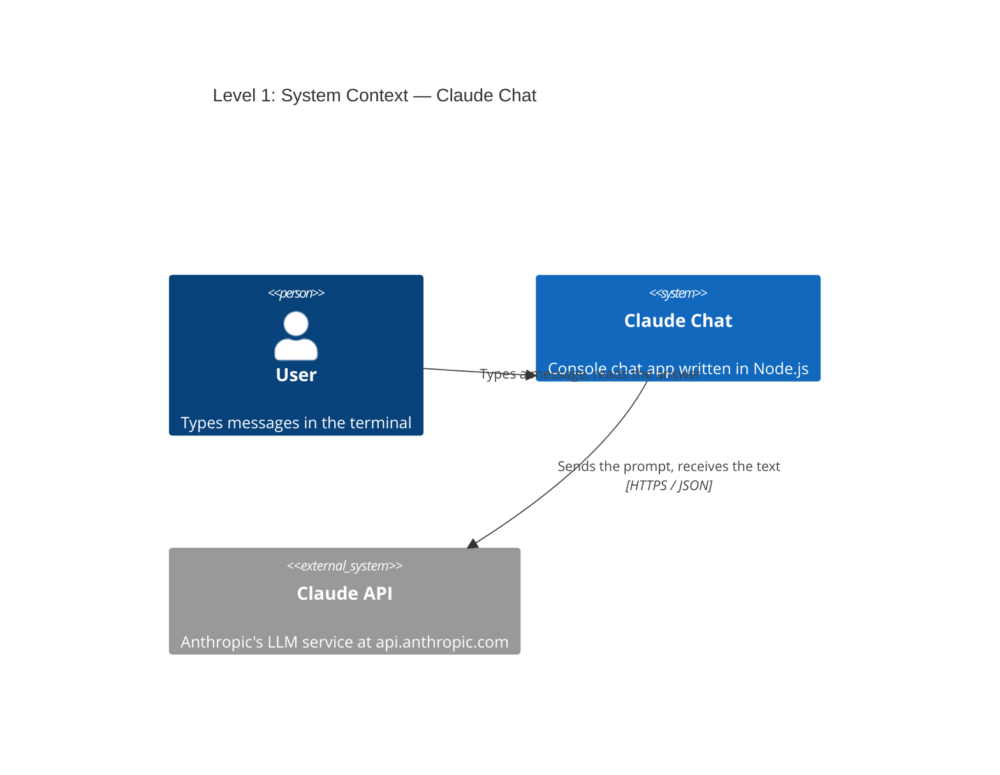
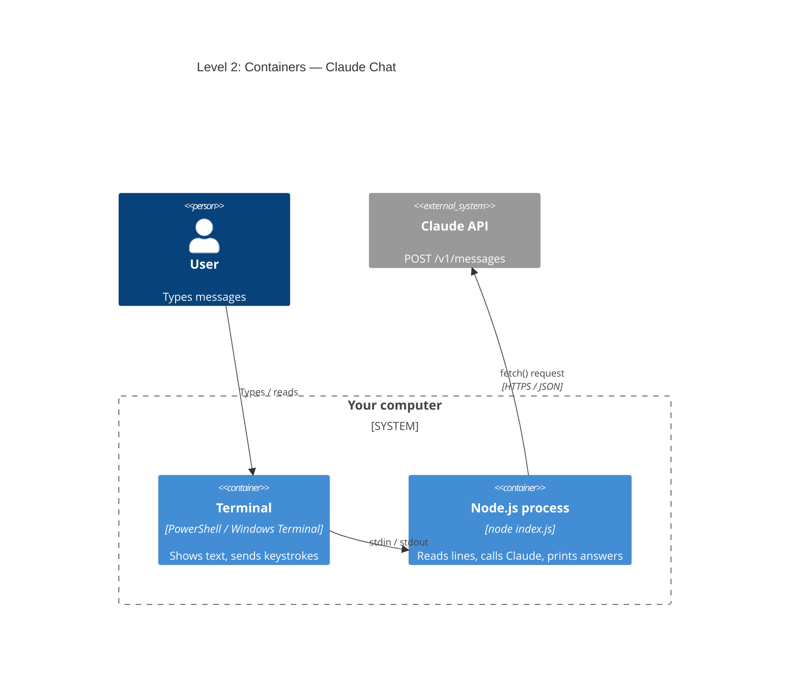
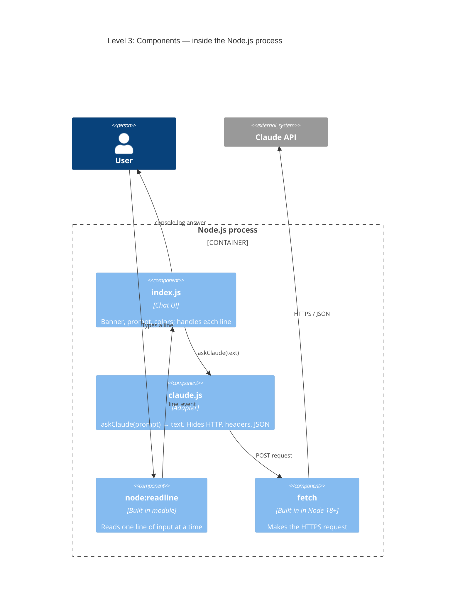
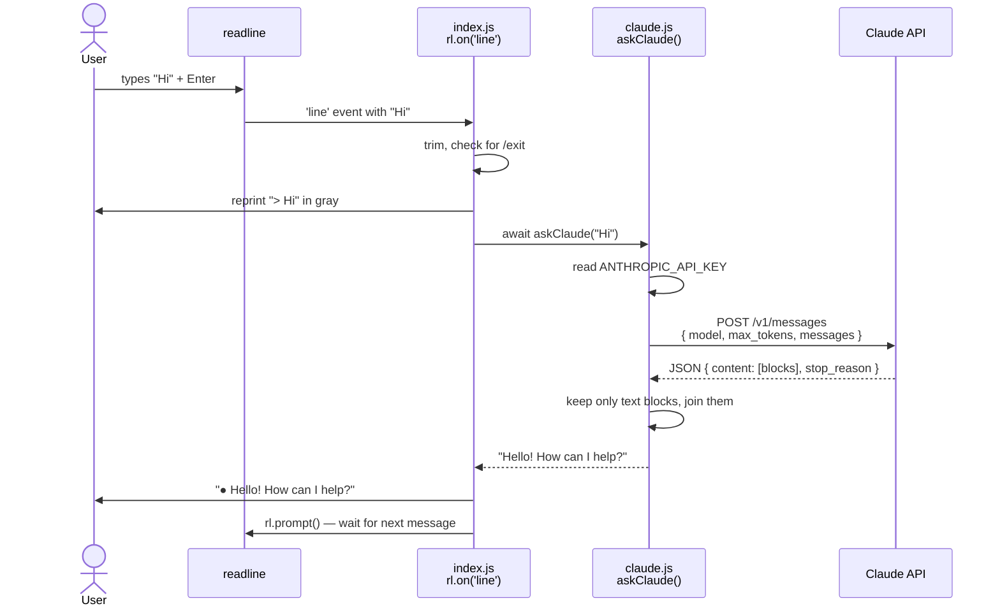

# Claude Chat — C4 diagrams

The C4 model describes software at 4 zoom levels:
1. **Context**: who uses the system and which outside systems it talks to.
2. **Container**: the separately running parts (apps, processes).
3. **Component**: the building blocks inside one container (here: files/modules).
4. **Code**: how the code actually runs, step by step.

---

## Level 1 — System Context

The big picture: you type in a terminal, the app asks Claude, Claude answers.

---

## Level 2 — Container

Zoom into "Claude Chat": it's one Node.js process running in your terminal.

---

## Level 3 — Component

Zoom into the Node.js process: two files of ours plus Node's built-in modules.

---

## Level 4 — Code

What happens when you press Enter, step by step.

If anything fails (no API key, wrong model, network error), `askClaude` throws an
error, and `index.js` catches it and prints `● Error: ...` instead of an answer.
